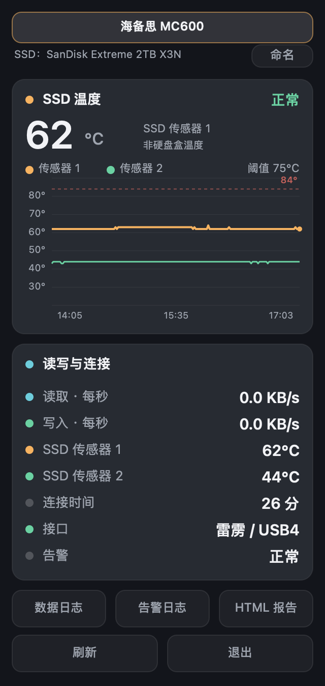

# DriveTemp

macOS 菜单栏外接硬盘温度监控，原生 Swift 编写，无第三方运行时依赖。



## 它解决什么问题

Mac 上看不到外接硬盘的温度。iStat Menus、Stats 这类工具只读 Apple 自家传感器，外接盘的温度藏在盘自己的 SMART 日志里，它们读不到。

这个工具直接调用 `smartctl` 读 NVMe 的 SMART 健康日志，把 SSD 报告的温度放进菜单栏，超过阈值弹通知，并保留历史曲线。

## 功能

- 菜单栏直接显示当前最高温度，点开是完整面板
- 面板依附菜单栏图标展开，点击外部、按 Esc 或再次点击图标即可收起
- 每块硬盘分别显示读取、写入速度，每秒更新，自动切换 KB/s、MB/s、GB/s
- 点击面板顶部「命名」可自定义名称、恢复自动名称，并查看原始硬盘型号和桥接标识；命名界面仍在菜单栏弹出面板内
- 多块盘同时在线，顶部标签切换，各自独立记录与告警
- 温度曲线带坐标轴刻度，固定 20 到 90 度量程，84 度为告警参考线
- 超过阈值（默认 75 度）弹系统通知，30 分钟内不重复提醒
- 记录连接时长，拔出清零，插回重新计时
- 数据存 CSV，可导出 HTML 报告

## 依赖

- macOS 13 或更高
- `smartctl`（smartmontools）

```bash
brew install smartmontools
```

脚本默认找 `~/.local/bin/smartctl`，找不到时回落到 PATH。如果装在别处，改 `main.swift` 顶部的 `smartctlPath`。

## 构建

```bash
xcode-select --install      # 需要 swiftc
./build.sh                  # 只编译到 build/
./build.sh install          # 编译并安装到 ~/Applications
```

装好后到 系统设置 > 通用 > 登录项 添加这个 app，就能开机自启。

## 配置

改阈值：

```bash
defaults write com.leo.tbtemp threshold 70
```

采样间隔、量程、曲线点数在 `main.swift` 顶部的常量区。

读写速度使用 macOS IOKit 提供的物理磁盘累计字节数做差，显示上一个采样区间的平均速率（十进制单位），不包含只命中系统文件缓存的读写。首次采样、重新连接或计数重置后需要等待下一次采样；无法获取计数时显示「不可用」。读写采集与温度查询在不同后台队列执行，温度仍每 15 秒采集一次。

### 自定义名称与温度来源

自定义名称保存在本机 `com.leo.tbtemp` 偏好设置的 `driveCustomNames` 中，优先按硬盘序列号关联，换端口仍可沿用；没有序列号时退回设备路径。名称跟随硬盘身份，不会自动判断更换硬盘盒。应用不会把某位用户的硬盘盒品牌硬编码为所有设备的名称。

温度字段「传感器 1 / 2」对应设备实际返回的 `Temperature Sensor 1 / 2`。NVMe SMART 编号本身不能证明传感器位于主控或闪存，也不提供传感器器件、SSD 主控芯片的具体型号。这些是 SSD 温度，不能当作硬盘盒外壳或桥接芯片温度。桥接标识沿所选物理盘的硬件父链读取，不会把总线上其他设备的名称关联到这块盘。

## 版本

- **2.1.1（2026-10-26）**：增加每秒读写速度、自定义名称和设备信息；改为点击外部即收起的菜单栏弹出面板，温度查询移至后台；温度标注改为设备报告的传感器编号，明确区分 SSD 与硬盘盒温度。
- **2.0**：原始温度监控、曲线、日志与告警版本。

## 文件位置

| 内容 | 路径 |
|---|---|
| 采样数据 | `~/Library/Logs/tb-monitor.csv` |
| 告警记录 | `~/Library/Logs/tb-alerts.log` |
| HTML 报告 | `~/Library/Logs/TBTemp-report.html` |
| 连接状态 | `defaults read com.leo.tbtemp connectedSince` |

CSV 格式：`时间,综合温度,传感器1,传感器2,告警,链路,设备序列号`。旧文件中「主控 / 闪存」列实际存储的也是传感器 1 / 2，历史数据与列位置保留。第七列是后加的，老数据的六列行会归到第一块盘。

## 支持范围与限制

**能读温度的前提**：硬盘走雷雳或 USB4 的 PCIe 隧道，`smartctl` 才能拿到 NVMe 的 SMART 日志。

**读不到的情况**：普通 USB 接口的移动硬盘，多数桥芯片不透传 SMART。典型报错：

```
Read NVMe SMART/Health Information failed: GetLogPage failed: code=706
```

这种盘会被识别出来，型号、接口、连接时间都正常，但温度显示「无数据」。这是盒子硬件的限制，换任何工具都一样。

内置的 Apple SSD 默认被排除，因为它不是「外接」，且没必要盯。

## 已知问题

- 未签名的本地编译应用，首次打开可能需要右键选择「打开」
- 曲线横轴按采样点均匀分布，不是严格时间轴，采样中断处不会留白

## 许可

MIT
